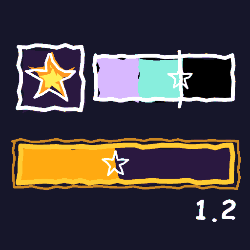
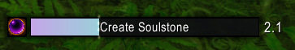
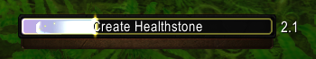
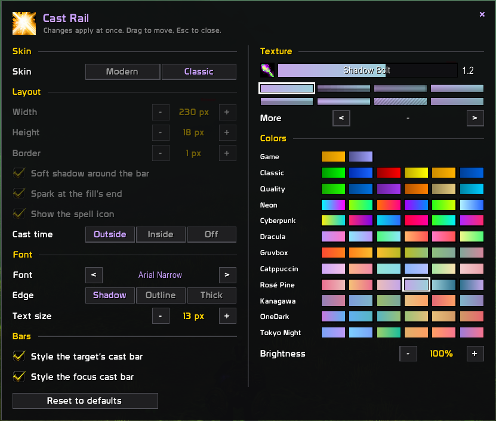

# Cast Rail

**WoW: Forever addon:** restyles your cast bars, with a flat modern look or one that
fits the classic UI.

- **Two skins.** *Modern*: a flat bar with a thin black edge, a soft shadow, the
  spell icon on the left and the cast time on the right. *Classic*: keeps the game's
  own frame, so it sits with the default UI; only the fill, font and time change.
- **Your colors:** the game's cast colors, your class color, Classic bar colors
  (Health, Mana, Rage, Energy, Cast bar, Rested), item quality colors (Uncommon to
  Heirloom), and the Neon, Cyberpunk, Dracula, Gruvbox, Catppuccin, Rosé Pine,
  Kanagawa, OneDark and Tokyo Night sets, the same as in XP Rail and Cooldown Skin.
  Interrupted casts always turn red and casts you can't interrupt turn grey, in
  every set.
- **Bar textures:** Flat, the game's own two, and five made for this addon
  (Smooth, Gloss, Rounded, Stripes, Matte). Textures other addons share through
  LibSharedMedia show up too.
- **Fonts:** Arial Narrow (fits long spell names), Friz Quadrata, Morpheus, Skurri,
  plus any LibSharedMedia fonts; with a shadow, an outline or a thick outline.
- **Cast time** outside the bar, inside it, or off. The spell name can be hidden too.
- **Channels show the spell's name** instead of "Channeling".
- Player, target and focus bars. The player bar stays where Edit Mode puts it.
- English and German.

## Install

Copy this repository's files into a folder named `CastRail` inside
`World of Warcraft\_forever_\Interface\AddOns\`.

## Options

Type `/castrail`, click Cast Rail in the minimap addon menu, or go to
Options > AddOns > Cast Rail. Every change applies at once.

| Command | What it does |
| --- | --- |
| `/castrail` or `/crail` | Open the options window |
| `/castrail modern` | Switch to the modern skin |
| `/castrail classic` | Switch to the classic skin |
| `/castrail reset` | Back to the defaults |

Going from the modern skin back to classic, or turning off the target or focus bar,
is cleanest after a `/reload`.

## Changes

See [CHANGELOG.md](CHANGELOG.md).

## License

MIT, see [LICENSE](LICENSE).
